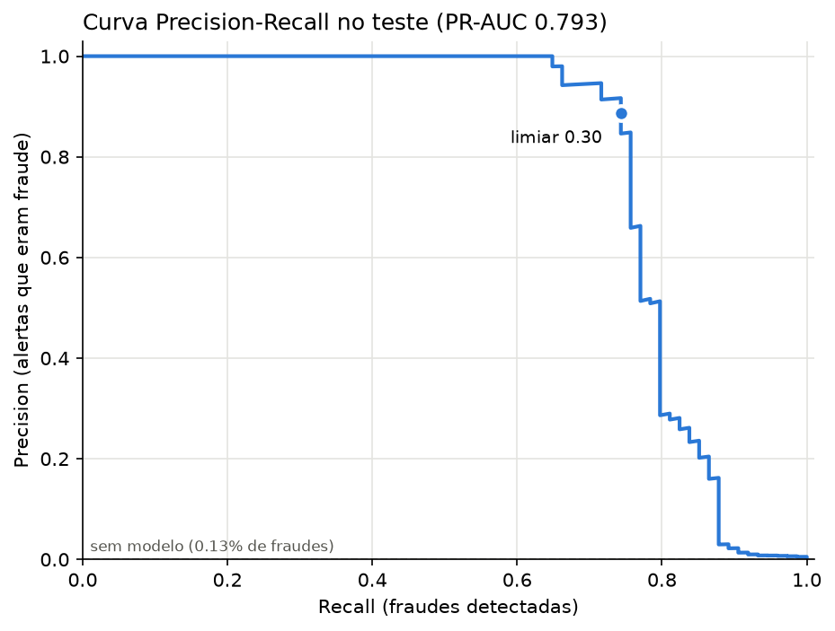

# Detecção de Fraude em Cartões de Crédito

[](https://github.com/LorenzoNMachado/deteccao-fraude-cartao/actions/workflows/ci.yml)

Modelo de Machine Learning para identificar transações fraudulentas, com o limiar de decisão escolhido pelo **custo de negócio**: o prejuízo de cada fraude não detectada contra o atrito de bloquear um cliente legítimo.

**Dataset:** [Credit Card Fraud Detection (Kaggle)](https://www.kaggle.com/datasets/mlg-ulb/creditcardfraud). São 284.807 transações de portadores europeus feitas em dois dias de setembro de 2013, com valores em euros. Só 0,17% delas são fraudes. As variáveis `V1` a `V28` vêm de uma PCA aplicada pelos autores para anonimizar os dados.

## Resultados

Medidos no conjunto de **teste**, que reúne as 56.746 transações mais recentes (74 fraudes). O modelo nunca viu esses dados antes da avaliação final.

| | Sem modelo | Com o modelo (limiar 0,30) |
|---|---|---|
| Fraudes detectadas | 0 de 74 | **55 de 74** (recall 74,3%) |
| Alertas que eram fraude | — | **88,7%** (precision) |
| Clientes bloqueados indevidamente | 0 | **7** |
| Custo total | €9.207,67 | **€3.054,03** (−67%) |

- **Modelo:** Gradient Boosting (`HistGradientBoostingClassifier`) com hiperparâmetros ajustados.
- **Qualidade do ranking:** PR-AUC de 0,793 e ROC-AUC de 0,983.
- **Variáveis mais importantes:** V14, V4, V10 e V12, pela importância por permutação.



### Modelo de custo

Os valores são **hipotéticos**; ajuste em `src/custo.py`:

- **Fraude não detectada (FN):** o valor da transação mais €20 de custo operacional (contestação).
- **Bloqueio indevido (FP):** €5, pelo contato com o cliente e o atrito.

Usar o valor real da transação é importante porque a maioria das fraudes é pequena: a mediana é de €9,25 e a média de €122. Um custo fixo alto por fraude empurraria o limiar para bloquear muitos clientes legítimos sem necessidade.


### Comparação de modelos

Os modelos foram comparados pela PR-AUC média numa validação cruzada temporal de 3 folds no treino:

| Modelo | PR-AUC (CV) |
|---|---|
| Gradient Boosting | **0,794** (± 0,044) |
| Random Forest + SMOTE | 0,790 (± 0,049) |
| Random Forest | 0,774 (± 0,058) |
| Regressão Logística | 0,722 (± 0,095) |

Os dois primeiros empatam dentro da margem de erro. O Gradient Boosting foi escolhido por treinar mais de dez vezes mais rápido. O SMOTE não trouxe ganho claro sobre a Random Forest sem ele.

## Metodologia

1. **Limpeza:** remoção das 1.081 transações duplicadas, que poderiam cair ao mesmo tempo no treino e no teste.
2. **Separação temporal:** treino com as 60% mais antigas, validação com as 20% seguintes e teste com as 20% mais recentes. É como o modelo seria usado na prática: aprende com o passado e prevê o futuro.
3. **Escolha do modelo e dos hiperparâmetros:** validação cruzada temporal (`TimeSeriesSplit`) no treino, com a PR-AUC como métrica. Quando há SMOTE, ele fica **dentro** do pipeline do `imblearn`, para ser aplicado só nos dados de treino de cada fold.
4. **Limiar de decisão:** é o de menor custo no conjunto de **validação**.
5. **Avaliação:** feita uma única vez, no teste.
6. **Artefato:** um único arquivo `models/modelo_fraude.joblib`, com pipeline, limiar e lista de variáveis. Não há como usar o modelo com o limiar ou o pré-processamento errado.

### O que mudou em relação à versão anterior

A versão anterior relatava recall de 90,81% e custo de R$ 24.230. Reproduzi aquele script e encontrei dois vazamentos de informação que inflavam os resultados:

- **O limiar era escolhido no próprio conjunto de teste.** Escolhendo na validação, o mesmo modelo passa de 347 para 863 bloqueios indevidos no teste, e a precisão cai de 20% para 9%.
- **O SMOTE era aplicado antes da validação cruzada da busca de hiperparâmetros.** Fraudes sintéticas quase idênticas caíam no treino e na validação de cada fold, e o F1 da CV chegava a 0,9999. Com o SMOTE dentro do pipeline, o valor real é 0,839.

Além disso, o modelo salvo usava um limiar ajustado para outro modelo. Os números atuais são menores em recall, mas são medidas honestas do que o modelo faz com transações que ele nunca viu.

## Como executar

Requer Python 3.12 ou mais novo.

```bash
pip install -r requirements.txt
```

Baixe o `creditcard.csv` do [Kaggle](https://www.kaggle.com/datasets/mlg-ulb/creditcardfraud) e coloque em `data/`.

**Opção 1: direto do CSV**

```bash
python train_model.py --csv data/creditcard.csv
```

**Opção 2: com PostgreSQL no Docker**

```bash
cp .env.example .env            # troque a senha no .env
docker compose up -d            # sobe o PostgreSQL na porta 5432
python load_data.py             # grava data/creditcard.csv na tabela transactions
python train_model.py           # lê do banco (DATABASE_URL do .env)
```

O treino leva cerca de 5 minutos. Ele gera `models/modelo_fraude.joblib`, `reports/metricas.json` e os gráficos em `reports/figures/`.

**Usar o modelo treinado**

```python
import sys; sys.path.insert(0, 'src')
from modelos import carregar, prever

artefato = carregar('models/modelo_fraude.joblib')
resultado = prever(artefato, transacoes)   # DataFrame com as colunas V1..V28 e Amount
# colunas: prob_fraude, bloquear
```

**Testes:** rode `pip install pytest` e depois `pytest`. Entre eles há um teste do fluxo completo com dados sintéticos, que o GitHub Actions executa a cada push.

## Estrutura

```
train_model.py      treino (CLI)
load_data.py        carga do CSV no PostgreSQL (CLI)
src/dados.py        leitura (banco ou CSV), validação, duplicadas e separação temporal
src/modelos.py      modelos candidatos, espaços de busca, salvar/carregar/prever
src/custo.py        custo de negócio e escolha do limiar
src/treino.py       fluxo completo e gráficos
tests/              testes (pytest)
reports/            métricas e gráficos da última execução
docker-compose.yml  PostgreSQL
```

## Limitações

- A validação tem 57 fraudes e o teste tem 74. Com tão poucos casos, uma fraude a mais ou a menos muda o recall em cerca de 1,4 ponto percentual.
- Os custos são hipotéticos. Com outros valores, o limiar ideal muda, e o `src/custo.py` recalcula tudo.
- As variáveis anonimizadas (PCA) impedem interpretar o significado de V14, V4 e das demais.

## Autor

**Lorenzo Nakayama Machado**. Graduando em Ciência da Computação pela Pontifícia Universidade Católica do Paraná (PUCPR). Interesse em IA, Ciência de Dados e Desenvolvimento Python.
