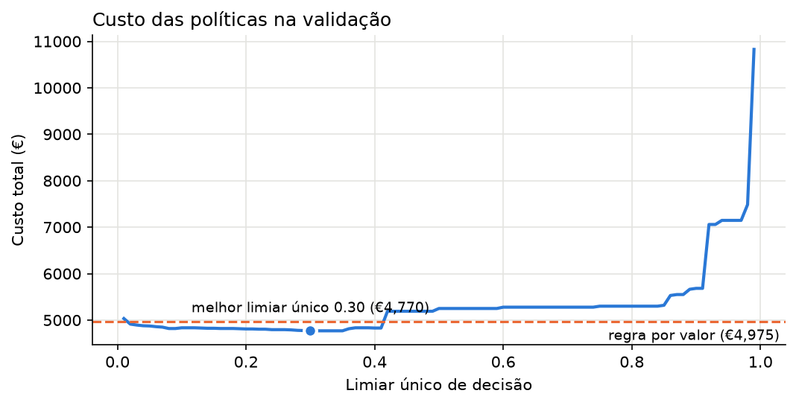
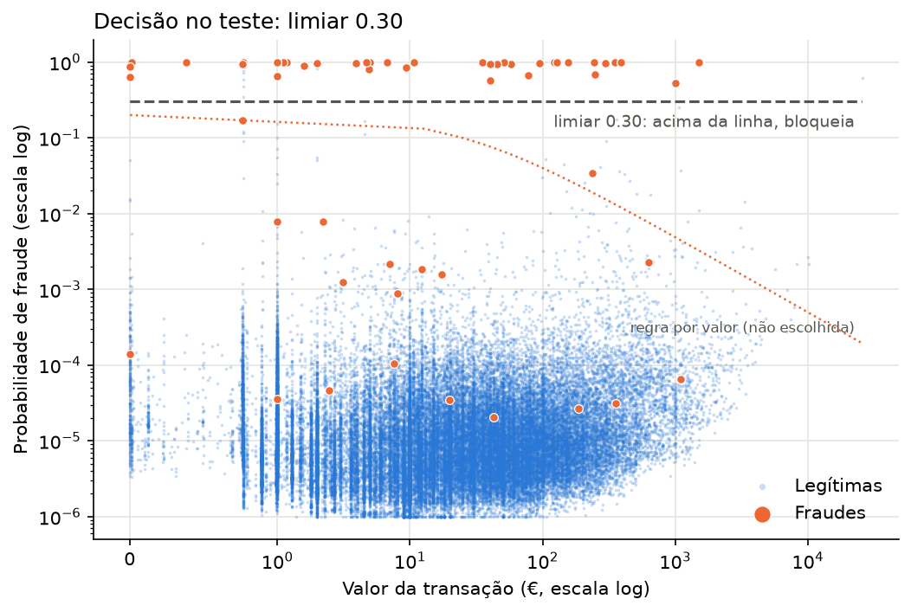

# Detecção de Fraude em Cartões de Crédito

[](https://github.com/LorenzoNMachado/deteccao-fraude-cartao/actions/workflows/ci.yml)
[-green.svg)](LICENSE)
[](SECURITY.md)

Modelo de Machine Learning para identificar transações fraudulentas, com a política de bloqueio escolhida pelo **custo de negócio**: o prejuízo de cada fraude não detectada contra o atrito de bloquear um cliente legítimo. O projeto inclui uma API em FastAPI que devolve o risco de cada transação e o motivo de cada alerta.

**Dataset:** [Credit Card Fraud Detection (Kaggle)](https://www.kaggle.com/datasets/mlg-ulb/creditcardfraud). São 284.807 transações de portadores europeus feitas em dois dias de setembro de 2013, com valores em euros. Só 0,17% delas são fraudes. As variáveis `V1` a `V28` vêm de uma PCA aplicada pelos autores para anonimizar os dados.

O CSV não é redistribuído neste repositório. O Kaggle identifica o dataset como “Database: Open Database, Contents: Database Contents”; veja [Dados e licenças](DATA_SOURCES.md) para atribuição e restrições dos relatórios derivados.

## Resultados

Medidos no conjunto de **teste**, que reúne as 56.746 transações mais recentes (74 fraudes). Os intervalos são de 95%, calculados por bootstrap com 1.000 reamostragens. Com tão poucas fraudes, a incerteza é grande e precisa aparecer junto dos números.

| | Sem modelo | Com o modelo (limiar 0,30) |
|---|---|---|
| Fraudes detectadas | 0 de 74 | **55 de 74**: recall 74,3% (IC 64,7%–84,0%) |
| Alertas que eram fraude | — | **88,7%** (IC 81,0%–95,7%) |
| Clientes bloqueados indevidamente | 0 | **7** |
| Custo total | €9.207,67 | **€3.054,03**: economia de 66,8% (IC 41,5%–90,2%) |

- **Modelo:** Gradient Boosting (`HistGradientBoostingClassifier`) com hiperparâmetros ajustados.
- **Qualidade do ranking:** PR-AUC de 0,793 (IC 0,710–0,873).
- **Variáveis mais importantes:** V14, V4, V10 e V12, pela importância por permutação.


### Por que cada transação foi bloqueada

Cada alerta vem com os fatores que mais aumentaram o risco, calculados com valores SHAP. Exemplos de alertas no teste (todos eram fraudes de verdade):

| Valor | Risco | Motivo 1 | Motivo 2 | Motivo 3 |
|---|---|---|---|---|
| €127,14 | 99,8% | V14 = −4,29 | V12 = −5,27 | V10 = −4,53 |
| €50,00 | 99,8% | V14 = −4,69 | V10 = −4,49 | V12 = −2,64 |
| €349,08 | 99,8% | V14 = −4,70 | V12 = −3,91 | V4 = 2,40 |

A lista completa dos 10 alertas de maior risco está em `reports/alertas_exemplo.csv`.

## Modelo de custo e política de bloqueio

Os valores são **hipotéticos**; ajuste em `src/custo.py`:

- **Fraude não detectada (FN):** o valor da transação mais €20 de custo operacional (contestação).
- **Bloqueio indevido (FP):** €5, pelo contato com o cliente e o atrito.

Duas políticas foram comparadas na **validação**:

- **Limiar único:** bloqueia quando a probabilidade passa de um valor fixo, buscado entre 0,01 e 0,99. O melhor foi 0,30, com custo de €4.770.
- **Regra por valor:** bloqueia quando a perda esperada de liberar supera o custo de bloquear, ou seja, `p × (valor + 20) > (1 − p) × 5`. Assim, uma compra cara é bloqueada com risco menor que uma barata. Custou €4.975.

O limiar único venceu e é a política usada. No teste, a regra por valor teria custado €2.932, um pouco menos. Ainda assim, a escolha é feita na validação para não usar o teste duas vezes, e a diferença fica dentro da margem de incerteza. A regra por valor depende de probabilidades bem calibradas. A calibração sigmoide foi testada, mas não melhorou o modelo: o Brier na validação piorou de 0,000312 para 0,000320. Isso provavelmente pesou contra a regra.





## Comparação de modelos

Os modelos foram comparados pela PR-AUC média numa validação cruzada temporal de 3 folds no treino:

| Modelo | PR-AUC (CV) |
|---|---|
| Gradient Boosting | **0,794** (± 0,044) |
| Random Forest + SMOTE | 0,790 (± 0,049) |
| Random Forest | 0,774 (± 0,058) |
| Regressão Logística | 0,722 (± 0,095) |

Os dois primeiros empatam dentro da margem de erro. O Gradient Boosting foi escolhido por treinar mais de dez vezes mais rápido. Com o ajuste de hiperparâmetros, a PR-AUC na CV foi a 0,797.

Duas outras ideias foram testadas com os mesmos folds e descartadas por não melhorar o resultado:

- **Hora do dia como variável:** a PR-AUC caiu de 0,797 para 0,790.
- **Calibração das probabilidades:** já descrita na seção anterior.

## Metodologia

1. **Limpeza:** remoção das 1.081 transações duplicadas, que poderiam cair ao mesmo tempo no treino e no teste.
2. **Separação temporal:** treino com as 60% mais antigas, validação com as 20% seguintes e teste com as 20% mais recentes.
3. **Escolhas no treino:** modelo, hiperparâmetros e variáveis são escolhidos por validação cruzada temporal (`TimeSeriesSplit`), com a PR-AUC como métrica. Quando há SMOTE, ele fica **dentro** do pipeline do `imblearn`, para ser aplicado só nos dados de treino de cada fold.
4. **Escolhas na validação:** a calibração e a política de bloqueio.
5. **Avaliação:** feita uma única vez, no teste, com intervalos de confiança por bootstrap.
6. **Modelo de produção:** depois da avaliação, é retreinado com **todas** as 283.726 transações, mantendo todas as escolhas anteriores. Assim ele também aprende com as fraudes mais recentes.
7. **Artefato:** um único arquivo `models/modelo_fraude.joblib`, com pipeline, política de bloqueio, lista de variáveis e uma amostra de referência para as explicações.

### O que mudou em relação à primeira versão

A primeira versão relatava recall de 90,81% e custo de R$ 24.230. Reproduzi aquele script e encontrei dois vazamentos de informação que inflavam os resultados:

- **O limiar era escolhido no próprio conjunto de teste.** Escolhendo na validação, o mesmo modelo passa de 347 para 863 bloqueios indevidos no teste.
- **O SMOTE era aplicado antes da validação cruzada da busca de hiperparâmetros.** O F1 da CV chegava a 0,9999; com o SMOTE dentro do pipeline, o valor real é 0,839.

## Como executar

Requer Python 3.12 ou mais novo.

```bash
pip install -r requirements.txt
```

Baixe o `creditcard.csv` do [Kaggle](https://www.kaggle.com/datasets/mlg-ulb/creditcardfraud) e coloque em `data/`.

**Treino direto do CSV**

```bash
python train_model.py --csv data/creditcard.csv
```

**Treino com PostgreSQL no Docker**

```bash
cp .env.example .env            # troque a senha no .env
docker compose up -d --wait     # sobe o PostgreSQL na porta 5432
python load_data.py             # grava data/creditcard.csv na tabela transactions
python train_model.py           # lê do banco (DATABASE_URL do .env)
```

O treino leva cerca de 6 minutos. Ele gera `models/modelo_fraude.joblib`, `reports/metricas.json`, `reports/alertas_exemplo.csv` e os gráficos em `reports/figures/`.

**API**

```bash
uvicorn api:app                 # documentação interativa em http://localhost:8000/docs
# ou, em container (depois do treino):
docker build -t fraude-api . && docker run -p 8000:8000 fraude-api
```

- `GET /saude`: status, política de bloqueio e informações do modelo.
- `POST /prever`: recebe uma lista de transações (`Time`, `Amount`, `V1`..`V28`) e devolve, para cada uma, `prob_fraude`, `bloquear` e `motivos`. Os motivos vêm só para as transações bloqueadas.

A API rejeita valores não finitos, valores negativos em `Time`/`Amount` e lotes acima de 1.000 transações. O container executa como usuário sem privilégios. `joblib` desserializa arquivos com semântica de pickle; carregue somente o artefato local gerado pelo treinamento deste projeto.

**Uso em Python**

```python
import sys; sys.path.insert(0, 'src')
from modelos import carregar, explicar, prever

artefato = carregar('models/modelo_fraude.joblib')
resultado = prever(artefato, transacoes)       # prob_fraude, bloquear
motivos = explicar(artefato, transacoes)       # Motivo 1..3
```

**Testes:** rode `pip install pytest httpx` e depois `pytest`. O GitHub Actions roda dois jobs a cada push:

- **Testes unitários:** incluem o fluxo completo com dados sintéticos.
- **Integração:** sobe o PostgreSQL pelo `docker-compose.yml`, carrega dados sintéticos com `load_data.py`, treina lendo do banco, constrói a imagem da API e chama os endpoints.

## Estrutura

```
train_model.py      treino (CLI)
load_data.py        carga do CSV no PostgreSQL (CLI)
api.py              API FastAPI
src/dados.py        leitura (banco ou CSV), validação, duplicadas, hora e separação temporal
src/modelos.py      modelos, espaços de busca, artefato, previsão e explicações (SHAP)
src/custo.py        custo de negócio, limiar e regra por valor
src/avaliacao.py    métricas de uma política e intervalos de confiança (bootstrap)
src/treino.py       fluxo completo e gráficos
src/sintetico.py    transações sintéticas para testes e CI
tests/              testes (pytest)
reports/            métricas, alertas de exemplo e gráficos da última execução
Dockerfile          imagem da API
docker-compose.yml  PostgreSQL
```

## Limitações

- O teste tem 74 fraudes. Por isso os intervalos de confiança são largos: a economia pode ficar entre 42% e 90%.
- Os custos são hipotéticos. Com outros valores, a política ideal muda, e `src/custo.py` recalcula tudo.
- São só dois dias de dados. Não dá para medir se o padrão das fraudes muda com o tempo (*drift*).
- As variáveis anonimizadas (PCA) impedem interpretar o que V14, V4 e as demais significam.

## Licença e segurança

A licença MIT cobre o código original; não concede direitos sobre dados e
artefatos derivados. A política para relatos privados está em
[`SECURITY.md`](SECURITY.md). O CI executa testes com dados sintéticos e uma
integração com PostgreSQL e Docker; isso não equivale a uma auditoria de
segurança do sistema em produção.

## Autor

**Lorenzo Nakayama Machado**. Graduando em Ciência da Computação pela Pontifícia Universidade Católica do Paraná (PUCPR). Interesse em IA, Ciência de Dados e Desenvolvimento Python.
